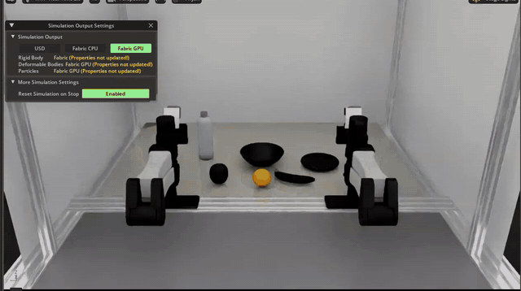

# dreamlabs-isaaclab

> **Docs: https://kabilankb.github.io/dreamlabs-isaaclab/** (install, API key setup, launching the page, testing the API).
> An independent project, not affiliated with Dream Labs. Third-party credits and licences: [NOTICE](NOTICE). Apache-2.0.
> The YAM robots need [YAMLab](https://github.com/ARISE-Initiative/yamlab) on Isaac Sim 6; the reBot robots need
> [rebot-duo-course](https://github.com/kabilankb/rebot-duo-course) (for its `rebot-sim-pipeline`). Both are optional: a
> robot whose checkout is missing shows as "not ready" on the launcher page.

> **Tested on a Dell Pro Max 16 Plus** (NVIDIA RTX PRO 5000 Blackwell laptop GPU): the simulator and launcher run locally on
> the Dell; only the model request goes to Dream's hosted API.

## Demo

[](media/demo.mp4)

The launcher page picks the **YAM · apple into the bowl** robot and the instruction "put orange into the bowl"; **Launch**
starts Isaac Lab with Dream-1 driving the arms, and the clip ends with the orange in the bowl. One recorded run, zero-shot
(the address bar is blurred). Click the animation for the full 74 s video: [`media/demo.mp4`](media/demo.mp4).

Run Dream Labs' **Dream-1** in Isaac Lab scenes: the bimanual **Seeed reBot B601** of this course, and **YAMLab's
YAM** (Dream's native robot, used as a control).

An independent integration, not an official Dream Labs package: it uses the public `dreamlabs` library and API.
Import name `dreamlabs_isaaclab`; Dream's own library imports as `dream`, so the two do not collide.

Dream-1 is served by Dream's API. This package gives an Isaac Lab scene the three things it needs to use it: an
observation (camera frames and joint state), the conversion of Dream's answer back into the scene's action units, and
a process bridge, because the two libraries cannot share a Python environment.

```
Isaac Sim env (env_yamlab6)                            Dream env (~/dream-env)
  dreamlabs_isaaclab.rebot / .yam                        dreamlabs_isaaclab/bridge.py
  scene · cameras · units  ──JSON lines, pipes──▶        dreamlabs client ──HTTPS──▶ Dream-1
        ▲                                                       │
        └──── action chunk: 48 rows × (6 joints rad + grip 0..1) at 20 Hz ◀──┘
```

Why two environments: `dreamlabs` pins `numpy==2.2.6`, `jax==0.7.1` and more, which would break Isaac Sim's Python.
The sim client starts the bridge as a subprocess; there is no server and no open port.

## Contents

| Path | What it is | Runs in |
|---|---|---|
| `src/dreamlabs_isaaclab/rebot.py` | Dream-1 drives the bimanual reBot scene of `rebot-sim-pipeline` | Isaac env |
| `src/dreamlabs_isaaclab/yam.py` | Dream-1 drives YAMLab's bimanual YAM (`PutPotOnCooktop-v0`, patched to the gear task) | Isaac env |
| `src/dreamlabs_isaaclab/client.py` | `Bridge` (starts and talks to the bridge), JPEG encoding, embodiment loading. No Isaac or Dream imports | Isaac env |
| `src/dreamlabs_isaaclab/units.py` | Gripper and chunk-timing conversions, pure functions, unit tested | Isaac env |
| `src/dreamlabs_isaaclab/bridge.py` | Holds the `DreamClient`, retries a replaced session, answers JSON requests | Dream env |
| `src/dreamlabs_isaaclab/convert.py` | LeRobot **v3.0 → v2.1** dataset converter (Dream's uploader takes v2.1) | Dream env |
| `src/dreamlabs_isaaclab/validate.py` | Checks a v2.1 dataset against the reBot embodiment, locally; nothing is sent | Dream env |
| `src/dreamlabs_isaaclab/configs/` | `rebot_bimanual_embodiment.json` (joints; for a fine-tune) and `rebot_zero_shot_embodiment.json` (adds the EEF parts the client computes) | both |

## Quick start: one script

```bash
git clone https://github.com/kabilankb/dreamlabs-isaaclab && cd dreamlabs-isaaclab
./launch.sh            # installs what is missing, then opens the launcher page
./launch.sh --check    # only reports what is ready and what is missing (changes nothing)
```

`launch.sh` checks each step first, so it is safe to run again: Isaac Sim's Python (required, only checked; nothing is
installed if it is missing), the Dream environment `~/dream-env` (created with `uv`, then `dreamlabs`, `pyarrow`, `av`), your
API key (only checks that one is saved; add it on the page), Dream's MuJoCo-scene assets (converted into
`~/.dreamlabs-isaaclab/assets`), the YAMLab apple-in-bowl task (added to `~/yamlab6` if you have it), and the reBot task
(from your `rebot-duo-course` checkout; optional). Then it starts the launcher. Options: `--install-only`, `--no-browser`, `--port N`; paths can
be overridden with `DREAMLABS_ISAAC_PYTHON`, `DREAMLABS_DREAM_ENV`, `DREAMLABS_YAMLAB`, `DREAMLABS_ASSETS_DIR`.
It never pipes a downloaded script into a shell and never prints or passes on your API key.

The sections below are the same steps done by hand.

## Setup

```bash
# 1. The Dream env (once). Python 3.11-3.13.
curl -LsSf https://astral.sh/uv/install.sh | sh
uv venv --seed --python 3.12 ~/dream-env && . ~/dream-env/bin/activate
pip install --upgrade dreamlabs pyarrow av        # a numpy/jax stack: keep it out of the Isaac env

# 2. Your API key, in your own terminal (never paste it into a chat or a command line), or from the launcher page:
#    Dream's "Set up API" page gives a script that writes ~/.dreamlabs/credentials (mode 600).

# 3. This package into the Isaac env (numpy and Pillow only)
conda activate env_yamlab6 && pip install -e .          # from the cloned folder

# 4. Dream's MuJoCo scene as USD assets (apple, bowl, banana, orange, bottle, plate). Needs step 1's example installed.
python -m dreamlabs_isaaclab.mujoco_scene_assets
python -m dreamlabs_isaaclab.verify_assets --headless          # optional physics check
```

Two simulators can use the scene, and each needs its simulator checkout:

| Robot | Needs | Task |
|---|---|---|
| YAM | YAMLab on Isaac Sim 6 (`~/yamlab6`) with the new `PutAppleInBowl-v0` task (3 files + 2 registry lines, see below) | `--task PutAppleInBowl-v0` |
| reBot B601 duo | the `rebot-sim-pipeline/` of [rebot-duo-course](https://github.com/kabilankb/rebot-duo-course) (not a `~/rebot-sim-pipeline` working copy), the single-arm reBot project for the arm assets | `--task apple_in_bowl` |

**Which `rebot-sim-pipeline`?** The apple task needs four small optional extensions (fixed layouts, ready-made USD assets, a
success rule that counts only the target object, per-object grasp-assist settings). They are in the copy that
`rebot-duo-course` ships (clone it, or set `DREAMLABS_COURSE_REPO`; `launch.sh` looks next to this folder and in `~/rebot-duo-course`); the launcher puts that copy first on the path. Your own working copy is
untouched: copy the changed files over (`git diff -- rebot-sim-pipeline`) if you want the task there. The pen task behaves
as before in both.

**What was added to `yamlab6`** (nothing existing was changed except two registrations):
`yamlab/configs/tasks/put_apple_in_bowl.yaml`, `yamlab/envs/tasks/put_apple_in_bowl_manager_cfg.py`,
`yamlab/envs/tasks/put_apple_in_bowl_manager.py`, one import pair in `yamlab/envs/tasks/__init__.py` and one line in
`yamlab/envs/robot_registry.py`. Copies are kept in `yamlab6-task/` of this package so they can be re-applied.

## Run

```bash
# The reBot duo, zero-shot (headless; add --viz kit --realtime to watch)
python -m dreamlabs_isaaclab.rebot --episodes 3 --seed 1000 \
    --instruction "pick up the red pen and put it in the pencil cup"

# The reBot duo in Dream's MuJoCo scene (needs step 4 above)
python -m dreamlabs_isaaclab.rebot --task apple_in_bowl --episodes 3 --seed 1000

# YAMLab's YAM in Dream's MuJoCo scene (the assets are found automatically)
cd ~/yamlab6 && python -m dreamlabs_isaaclab.yam --task PutAppleInBowl-v0 --enable_gripper_clamp --enable_cameras --viz kit

# YAMLab's YAM, the gear task patched into PutPotOnCooktop-v0 (use its gear assets)
cd ~/yamlab6 && D=yamlab_datasets/tasks_data/PutPotOnCooktop/objects
python -m dreamlabs_isaaclab.yam --task PutPotOnCooktop-v0 \
    --asset pot=$D/Gear/factory_gear_medium --asset cooktop=$D/GearBase/factory_gear_base \
    --instruction "Pick up the gear and place it on the middle shaft of the gear base" \
    --num_episodes 1 --enable_gripper_clamp --enable_cameras --viz kit

# Dataset for a fine-tune: convert and check, locally (the Dream env)
~/dream-env/bin/python -m dreamlabs_isaaclab.convert DATASET_V3 DATASET_V21
~/dream-env/bin/python -m dreamlabs_isaaclab.validate DATASET_V21
```

Only one sim should use a key at a time: two clients on one account replace each other's sessions.

Tests (no simulator needed): `pip install -e .[dev] && pytest`.

## Test the Dream API

```bash
python -m dreamlabs_isaaclab.api_check                # your key saved? accepted by Dream? which models? (free)
python -m dreamlabs_isaaclab.api_check --call-model   # plus one real request (uses account credits)
```

The same tests are buttons on the launcher page (**Check key**, **Test connection**, **Send a test request**). The request
sends grey camera frames and a neutral pose and expects 48 rows of 7 values back; it checks the API, not the model's skill.
Exit code 0 means every check that was run passed. See the [docs](https://kabilankb.github.io/dreamlabs-isaaclab/#test).

## Usage and estimated spend, per task

```bash
python -m dreamlabs_isaaclab.usage                       # per task: requests, episodes, model time, success, estimated cost
python -m dreamlabs_isaaclab.usage --by run              # or: robot, model, run, day
python -m dreamlabs_isaaclab.usage --import-csv ~/Downloads/dreamlabs-usage-2026-11.csv   # use Dream's own price
```

Each finished episode writes one line to `~/.dreamlabs-isaaclab/usage.jsonl` (no frames, no key). Requests and timings are
measured; **money is an estimate**, because Dream's library has no usage or price call: it is your rate (or Dream's, derived
from its usage export) times the measured usage, and Dream's account page is the authority on what you were charged. The
export import keeps a copy without the key identifier and reconciles Dream's total against what the ledger can attribute to a
task. The launcher page shows the same table. Details: the [docs](https://kabilankb.github.io/dreamlabs-isaaclab/#usage).

## The launcher page

```bash
python -m dreamlabs_isaaclab.launcher        # or: dreamlabs-launcher   (any Python; standard library only)
```

It prints an address like `http://127.0.0.1:8765/?token=…` and opens it. On the page:

1. **Robot**: reBot B601 duo or YAM in Dream's apple-in-the-bowl scene, the reBot's stationery task, YAM gear assembly
   (YAMLab), or Dream's own YAM MuJoCo sim. A card says
   "Not ready" and names what is missing (a path, the gear assets) when the machine cannot run it.
2. **API & model**: shows whether a Dream key is saved (last four characters only) and whether Dream accepts it; paste a
   new key to verify and save it; pick a model from your account (public models and your fine-tunes) or type a model id.
3. **Run**: the instruction (with example chips), episodes, first layout seed, window or headless, real-time pacing.
   "Show the command" prints exactly what will run. **Launch** starts it; **Stop** ends the simulator and the bridge.
4. **Output**: status, the progress lines, a per-episode results table, and the run folder
   (`~/.dreamlabs-isaaclab/runs/<time>-<robot>/`: `command.txt`, `run.log`, `results.json`, the video).

Paths come from the defaults in `launch_spec.Paths` and can be changed with `DREAMLABS_ISAAC_PYTHON`,
`DREAMLABS_DREAM_PYTHON`, `DREAMLABS_REBOT_SIM_PIPELINE`, `DREAMLABS_YAMLAB` and `DREAMLABS_RUNS`.

**Logo.** If `~/.dreamlabs-isaaclab/logo.png` exists (a small PNG, 256 KB at most), the page shows it as a "via" mark next to
the API section. Dream Labs' logo is not shipped with this package or kept in the repository: put your own copy there.
Without the file the page simply shows no mark. The footer states that the page is independent of Dream Labs.

Safety of the page: it listens on 127.0.0.1 only; every request needs the random token in the address; changing requests
must be JSON with a matching `Host` and `Origin` (so another web page cannot drive it); the commands are built from
validated values and run without a shell; one run at a time; the key is never in a command, an environment variable or a
log. Anyone holding the address can start simulators on this machine, so keep it private.

## Dream's MuJoCo scene, as Isaac Lab assets

Dream's own YAM simulator (the one where Dream-1 completes "put apple into the bowl") has a bowl, an apple, a banana,
an orange, a water bottle and a plate. `mujoco_scene_assets` rebuilds those six objects as USD, one YAMLab-style asset
folder each (`<Name>/<name>_000/<name>_000.usd` + `asset_size.json` + textures), origin at the bottom centre, +Z up:

```bash
python -m dreamlabs_isaaclab.mujoco_scene_assets          # Isaac env Python; reads the installed Dream example, writes
                                                          # ~/.dreamlabs-isaaclab/assets/yam_mujoco_scene/
python -m dreamlabs_isaaclab.verify_assets --headless     # physics check: apple settles in the bowl, the rest rest on the floor
```

| Object | Size (cm) | Mass | Collision |
|---|---|---|---|
| apple (YCB scan) | 6.6 × 6.5 × 6.3 | 120 g | convex hull |
| banana (YCB scan) | 8.5 × 14.0 × 2.9 | 45 g | convex decomposition |
| bowl (lathed, open cavity) | 16.6 × 16.6 × 5.5 | 2 kg | convex decomposition |
| orange | 6.4 × 6.4 × 6.0 | 110 g | convex hull |
| water bottle | 5.9 × 5.9 × 18.4 | 276 g | convex hulls |
| plate | 14.6 × 14.6 × 1.3 | 300 g | convex hull (rim is visual only) |

`scene_layout.json` records where each object sits in Dream's scene (table top at z = 0.76 m).
The fruit are YCB scans under **CC BY 4.0**, so they are converted on your machine from the example you installed and not
copied into this repository; `ATTRIBUTION.txt` is written next to them.

**Status:** the assets load, collide and settle correctly (verified in Isaac Lab). They are **not yet placed in a task**:
YAMLab's task code is wired to two objects (`pot`, `cooktop`) with gear success thresholds, and the reBot scene is built
around pens in `rebot-sim-pipeline`, so each needs a new task variant (scene, reset layout, "apple in bowl" success check).

## How the reBot is mapped

- **Arm model.** Dream's built-in `seeed_faas` kinematics (a reBot B601). The base model reads end-effector poses; the
  client computes them from the joints and solves Dream's answer back to joints.
- **Joints.** The URDF joints of `seeed_faas` are assumed equal to the simulator's joint angles in radians. This follows
  from Dream's `joint_directions` equalling `rebot_sim_pipeline.conventions.LEADER_SCALE`; it is **not verified** on the
  sim's own kinematics.
- **Gripper.** Open fraction = mean finger opening / 0.05 m, both ways.
- **Cameras.** `top → overhead`, `left_wrist → wrist_l`, `right_wrist → wrist_r`, JPEG 640×360 (the 4:3 render is
  squashed to the model's 16:9).
- **Timing.** Dream's 20 Hz rows are played against simulated time (the reBot scene runs at 30 Hz); 30 rows are executed
  per chunk before the next request.

## Status (2026-11-01) - read this before trusting a number

All results are **single episodes**, so none is a success rate.

| Run | Outcome |
|---|---|
| Dream's own MuJoCo YAM sim, "put apple into the bowl" | The apple ended in the bowl. **Control: model and API work.** |
| reBot, "put the two pens and the eraser into the pencil cup" | Failed; the right arm hovered over the cup. |
| reBot, "pick up the red pen and put it in the pencil cup" | Failed. The eraser (not requested) ended held above the table; `pen_blue` ended on the floor (z = 0.004); `pen_red` stayed on the table. Nothing reached the cup. |
| YAMLab YAM, gear task | Failed; no pick within 900 steps. |

A correction to an earlier reading: the table surface is at z ≈ 0.755 m (`pen_red` rests at 0.7537), so a z of 0.75
means *on the table*, not lifted. Only the eraser (z = 0.82, grasped) was actually off the table.

Open questions, in order of how much they would change things:

1. Whether the reBot joint frame and gripper mapping above are right (a gripper that never releases is the symptom of a
   wrong gripper range or sign).
2. Whether the YAM adapter's image size, camera placement and 30 Hz → 20 Hz resampling hurt Dream-1 there.
3. Whether a fine-tune on the 52 demonstrations fixes the release (the converted dataset passes Dream's validator;
   **nothing has been uploaded**, and uploading sends about 700 MB to Dream and may be billed).

## Privacy and safety

- Zero-shot runs send camera frames and the task text to Dream on every model call.
- The API key lives only in `~/.dreamlabs/credentials`; the bridge reads it through the library, and no script here
  takes it as an argument.
- `convert.py` writes a new directory and refuses to write into a non-empty one; it never changes the source dataset.
- Nothing here touches real arms.
